# Claim Processing Architecture

How a hospital bill uploaded by a user flows through Azure messaging into the **ClaimOrchestrator** hosted agent. ClaimOrchestrator coordinates two Foundry **prompt agents**, a set of **tools**, and plain C# validation.

> Status: **design**. ClaimOrchestrator, the intake and policy prompt agents, and the C# validation exist today. Items marked ⓝ are new pieces this design needs. The [Review](#review-errors-and-gaps-in-the-proposed-flow) section explains why they're needed.

## Architecture

```mermaid
flowchart LR
    user["<b>User</b><br/>signs in with Entra ID"]

    subgraph web["Web app"]
        direction TB
        ui["<b>Upload UI</b><br/>browser"]
        api["<b>Claims API</b> ⓝ<br/>validates file type and size<br/>creates claimId<br/>returns a short-lived upload SAS"]
    end

    subgraph storage["Storage (private endpoints)"]
        direction TB
        blob[("<b>Blob Storage</b><br/>container: bills-incoming<br/>Defender malware scan ⓝ")]
        db[("<b>Claims DB</b> ⓝ<br/>Cosmos DB / Azure SQL<br/>claimId · status · outcome")]
    end

    subgraph messaging["Messaging"]
        direction TB
        eg["<b>Event Grid</b> ⓝ<br/>BlobCreated event"]
        sb[["<b>Service Bus queue</b><br/>claims-to-process<br/>message = claimId + blob path<br/>dead-letter queue ⓝ"]]
    end

    func["<b>Azure Function</b><br/>Service Bus trigger<br/>managed identity<br/>idempotent on claimId ⓝ"]

    subgraph foundry["Microsoft Foundry project"]
        direction TB
        subgraph hosted["<b>ClaimOrchestrator</b> · hosted agent · MAF workflow · managed identity"]
            direction TB
            s0["⓪ ExtractStep ⓝ<br/>read blob → text"]
            s1["① IntakeStep"]
            s2["② ValidateStep<br/>plain C#, no AI"]
            s3a["③a PolicyStep"]
            s3b["③b StopStep<br/>NeedsReview"]
            s0 --> s1 --> s2
            s2 -->|"IsValid = true"| s3a
            s2 -->|"IsValid = false"| s3b
        end
        intake["<b>Intake agent</b><br/>prompt agent<br/>bill text → JSON"]
        policy["<b>Policy agent</b><br/>prompt agent<br/>coverage answer"]
        search["<b>AI Search tool</b><br/>policy documents index"]
        model["<b>Model deployment</b>"]
    end

    docint["<b>Document Intelligence</b> ⓝ<br/>tool: PDF / image → text<br/>OCR for scanned bills"]
    review["<b>Human review queue</b> ⓝ<br/>NeedsReview claims"]
    appi["<b>Application Insights</b><br/>traces · no bill text in logs"]

    user -->|"1 upload bill"| ui
    ui -->|"2 request upload"| api
    api -->|"3 create claim, status Uploaded"| db
    ui -->|"4 PUT file with SAS"| blob
    blob -->|"5 BlobCreated"| eg
    eg -->|"6 message"| sb
    sb -->|"7 trigger"| func
    func -->|"8 status Processing"| db
    func -->|"9 invoke with claimId + blob path"| s0
    s0 -->|"read with managed identity"| blob
    s0 -->|"extract text"| docint
    s1 -->|"by name"| intake
    s3a -->|"by name"| policy
    policy --> search
    intake --> model
    policy --> model
    s3a -->|"10 PolicyChecked outcome"| func
    s3b -->|"10 NeedsReview outcome"| func
    func -->|"11 save outcome"| db
    func -->|"12 NeedsReview"| review
    ui -.->|"13 poll or SignalR for status"| api
    hosted -.-> appi
    func -.-> appi
```

## Agent and tool roles

| Component | Type | Owns | Decides routing? |
|---|---|---|---|
| ClaimOrchestrator | **Hosted agent** (MAF workflow in a container) | Order of steps, validation, routing | **Yes**, in C# |
| Intake agent | **Prompt agent** (Foundry) | Extracting structured JSON from bill text | No |
| Policy agent | **Prompt agent** (Foundry) | Answering "is this procedure covered?" | No |
| AI Search | **Tool** on the policy agent | Retrieving policy clauses | No |
| Document Intelligence | **Tool** called from ExtractStep ⓝ | Turning PDFs and images into text | No |
| ValidateStep | Plain C# code | Totals check, required fields | Produces the routing decision |

This is a **deterministic orchestration** pattern. The workflow, not an LLM, decides what happens next. Agents and tools only do the parts that need language understanding. For money decisions this is the right choice: it's testable, auditable and repeatable.

## Request flow

| # | From → To | What happens |
|---|---|---|
| 1–3 | User → UI → Claims API → DB | The API checks file type and size, creates a `claimId` with status `Uploaded`, and returns a write-only SAS for a single blob that expires in minutes. |
| 4 | UI → Blob | The browser uploads directly to `bills-incoming/{claimId}.pdf`. No storage keys reach the browser. |
| 5–6 | Blob → Event Grid → Service Bus | The `BlobCreated` event becomes a queue message containing only `claimId` and the blob path, never the file contents. |
| 7–8 | Service Bus → Function → DB | The Function is triggered and checks the claim isn't already processed (idempotency), then sets status `Processing`. |
| 9 | Function → ClaimOrchestrator | The Function invokes the hosted agent through the Foundry endpoint with its managed identity. |
| ⓪ | ExtractStep | Reads the blob (only from `bills-incoming`) and gets text from Document Intelligence. |
| ①–③ | Workflow | The existing intake → validate → policy-or-stop flow. |
| 10–12 | Function → DB / review | The Function saves the outcome, sends `NeedsReview` claims to human review and completes the Service Bus message. |
| 13 | UI → API | The UI shows the status and the result. |

## Review: errors and gaps in the proposed flow

Ordered by impact. **Must fix** means the flow won't work, or isn't safe for health data, without it.

### Must fix

1. **The orchestrator can't read a blob today.** ClaimOrchestrator expects bill **text** in the message. With a blob upload, something must turn the file into text first. A PDF can be a scan (an image), which needs OCR.
   **Fix:** add an **ExtractStep** at the start of the workflow that reads the blob and calls **Azure AI Document Intelligence** (`prebuilt-layout` or `prebuilt-invoice`). Keep it in the workflow so the hosted agent stays self-contained.

2. **Don't let the request choose any blob.** If the Function passes a blob URL and the agent reads whatever URL it's given, that's a server-side request forgery (SSRF) and data-access risk.
   **Fix:** pass `claimId` + blob **name** only. ExtractStep builds the path itself from one configured storage account and container, and rejects anything else.

3. **Service Bus delivers at least once.** The same claim can be processed twice: after a lock timeout, a Function crash or a retry. That means double agent calls and double cost.
   **Fix:** make the Function **idempotent**. Check and update the claim status by `claimId` before invoking, and enable Service Bus duplicate detection with `MessageId = claimId`.

4. **Long agent calls and Service Bus message locks.** Two LLM calls plus OCR can take 30–120 seconds. A Service Bus lock lasts at most 5 minutes.
   **Fix:** keep `maxAutoLockRenewalDuration` (Functions renews automatically) and set the Function timeout above the agent timeout. Use the Flex Consumption or Premium plan rather than classic Consumption (10-minute limit). Set `maxDeliveryCount` and use the **dead-letter queue** for poison messages.

5. **There's nowhere to store the result.** The flow ends at the orchestrator, but the user needs to see the outcome, and `NeedsReview` claims need a person.
   **Fix:** add a **Claims DB** (status + outcome) and a **review queue or UI**. The UI polls the API or gets a SignalR push.

6. **Hospital bills are health data (PHI).**
   **Fix:**
   - Use private endpoints for Blob, Service Bus, DB and Foundry.
   - Use managed identity everywhere, with no keys or connection strings.
   - Never log bill text or agent output in Application Insights.
   - Set a retention or deletion policy on `bills-incoming`.
   - Keep everything in one region for data residency.

### Should fix

7. **Uploaded files are untrusted.**
   - Turn on **Defender for Storage malware scanning**, and only process blobs that scan clean. The scan result can be the Event Grid trigger.
   - Enforce file type (`.pdf`, `.jpg`, `.png`) and a size limit in the Claims API.
   - The SAS must be write-only, for a single blob, and short-lived.

8. **Responses vs. Invocations protocol.** ClaimOrchestrator uses the **Responses** (chat) protocol, which suits conversations. A Function sending `{ claimId, blobName }` and expecting structured JSON is a better fit for the **Invocations** protocol (custom JSON in and out), which Microsoft recommends for non-conversational processing.
   **Fix:** switch the hosted agent to Invocations, or keep Responses and send the claim reference as the message text.

9. **Permissions for agent-to-agent calls.** The hosted agent's **managed identity** needs:
   - a role on the Foundry project (for example **Azure AI User**) to call the prompt agents;
   - **Storage Blob Data Reader** on `bills-incoming`;
   - access to Document Intelligence.

   The Function's identity needs permission to invoke the hosted agent.

10. **The prompt agents are shared.** If other apps also call the intake or policy agents, a change to their instructions changes this workflow's behaviour. **Fix:** pin agent **versions** in ClaimOrchestrator configuration, instead of always taking the latest.

### Nice to have

11. **Event Grid vs. the API sending the message.** Event Grid → Service Bus (as shown) fires only once the file actually exists. The alternative is for the Claims API to send the message after the upload finishes, which is simpler but relies on the browser calling back. Event Grid is more reliable.
12. **API Management** in front of the Claims API for throttling and WAF. This matches the existing external-path design. Whether to put APIM in front of Foundry is still an open decision and is left out here.
13. **Status and observability.** Emit one trace per claim (`claimId` as the correlation id) across Function → hosted agent → prompt agents, so a slow or failed claim can be followed end to end.
14. **Tools via the MCP server.** The `McpServer` folder could expose deterministic tools, such as policy-holder lookup or claim-history lookup, for the agents or the workflow to call. Keep money calculations in C#, not in prompts.

## What changes in the current code

| Change | Where | Why |
|---|---|---|
| Accept `{ claimId, blobName }` input instead of raw text | `ClaimOrchestratorAgent` | Fits the queue-driven flow (review 1, 2, 8) |
| Add `ExtractStep` (Blob read + Document Intelligence) before `IntakeStep` | `Workflow/ClaimSteps.cs`, `ClaimWorkflow.Build` | Review 1 |
| Configuration: storage account, container, Document Intelligence endpoint, agent versions | `appsettings.json` / `AppSettings` | Review 2, 9, 10 |
| New project: Azure Function with Service Bus trigger | `Foundry/ClaimFunction` (new) | Steps 7–12 |
| New project: Claims API + UI | new | Steps 1–4, 13 |

The existing intake → validate → policy/stop logic doesn't change.
